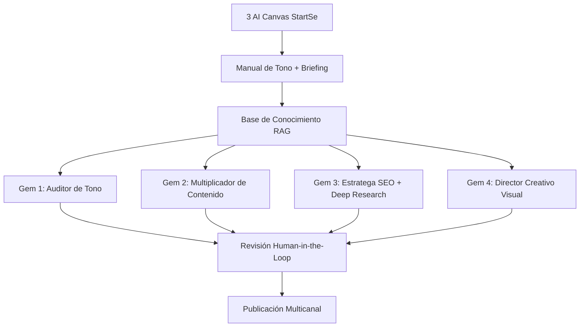
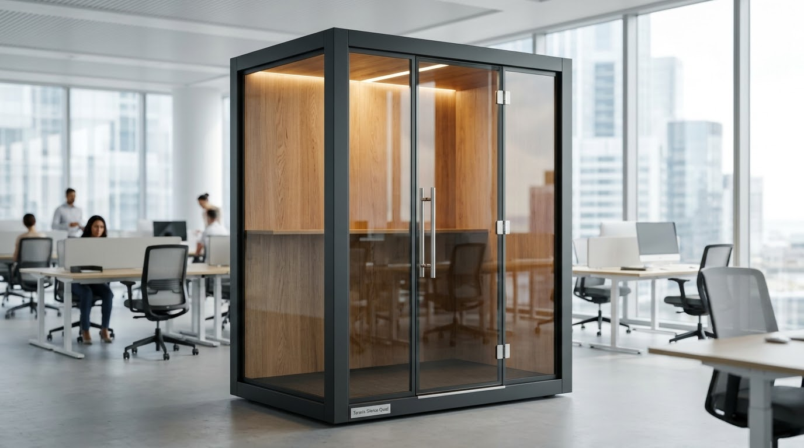

# Taranis Black Gems  
**Challenge One G11 — AI for Business**  
**Ruta 2: IA para Marketing y Contenidos**

Repositorio con todos los entregables del challenge aplicado a **Taranis Black** (mobiliario corporativo de ergonomía activa – líneas ErgoPro, SmartDesk y Silence).

> **Nota importante sobre la migración Gems → Skills (a partir del 17/11):**  
> De forma progresiva, las Gems de Google Gemini están migrando a **Skills**. Esto permitirá conectar varias Gems entre sí y trabajar directamente desde Gemini combinando capacidades.  
> A la fecha de este repositorio las Gems siguen vigentes. Los permisos otorgados para utilizarlas continuarán sin perjuicio de la migración.

---

## 📋 Orden real de creación (paso a paso)

1. **Primero se realizaron los 3 AI Canvas en StartSe**  
   Para entender la problemática y analizar los distintos puntos de cada caso de uso.  
   Cada Canvas contiene los **6 puntos clave**:

   | # | Punto del Canvas              | Descripción breve |
   |---|-------------------------------|-------------------|
   | 1 | **Problema**                  | Problema central del negocio |
   | 2 | **Como resolver SEM AI**      | Proceso actual (manual) |
   | 3 | **Como resolver COM AI**      | Solución AI by design |
   | 4 | **Para quem?**                | Personas / destinatarios |
   | 5 | **Dados**                     | Datos e fuentes |
   | 6 | **Ferramentas + Indicadores** | Herramientas e indicadores de sucesso |

   **Problema central (del documento de entrega):**  
   El equipo de marketing de Taranis Black (4 personas) gestiona simultáneamente LinkedIn, Instagram, TikTok y el blog. El tono de voz pierde consistencia, las imágenes dependen de freelancers que tardan en entregarlas y las respuestas en redes demoran más de 24 horas. Todo esto bajo un crecimiento anual >35%.

2. **Luego se crearon los Manuales de base de conocimiento**  
   - `docs/taranis_black_tono_de_voz_es_txt.txt` → Manual de Identidad Verbal y Tono de Voz v1.0  
   - `docs/taranis_black_briefing_de_marca_es_txt.txt` → Briefing de Marca Corporativo v1.0  

   Estos dos documentos son la **fuente de verdad (RAG)** que alimenta a todas las Gems.  
   En el Manual de Tono se usó la técnica de **few-shot prompting** (ejemplos de “Antes / Después”) para guiar al modelo.

3. **Se configuraron las 4 Gems** con los prompts de sistema (carpeta `prompts/`).

4. **Se generaron ejemplos reales** de uso de las Gems (carpeta `examples/`) y assets visuales (carpeta `assets/`).

---

## 🏗️ Arquitectura del sistema



### Agentes implementados

| # | Agente | Función principal | Archivo de prompt | Enlace a la Gema |
|---|--------|-------------------|-------------------|------------------|
| 1 | **Auditor de Identidad Verbal** | Evalúa borradores (1-10), detecta palabras prohibidas, reescribe en tono Taranis. | `prompts/auditor-de-tono-de-voz.md` | [Abrir Gema](https://gemini.google.com/gem/1mgUNS7Rsu6Oj_IeBkj4USKk39R5wjgn6?usp=sharing) |
| 2 | **Multiplicador de Contenido Semilla** | Transforma 1 contenido semilla → formatos listos (Blog, Email, LinkedIn, Newsletter, Carrusel, TikTok) | `prompts/multiplicador-de-contenido.md` | [Abrir Gema](https://gemini.google.com/gem/1lh6k7eX1xQh4-m-gcddIqn_ofa93MVXP?usp=sharing) |
| 3 | **Estratega SEO & Campañas** | Investigación real en Google (tendencias + PAA) + estructuras SEO. **Doble uso**: Mode 3 genera el calendario editorial completo. | `prompts/seo-estrategico.md` | [Abrir Gema](https://gemini.google.com/gem/18XQNusWRCaE35wQVHqIdaK1CyIRkGaFn?usp=sharing) |
| 4 | **Director Creativo Visual** | Fichas de dirección de arte + prompts técnicos en inglés para generación de imágenes | `prompts/director-creativo.md` | [Abrir Gema](https://gemini.google.com/gem/1hw6INvrdKpGI1MkEZKgBzumH-I3k60kN?usp=sharing) |

> **Nota importante sobre el Agente SEO**:  
> Primero realiza investigación en tiempo real (tendencias de mercado, People Also Ask, artículos que rankean). Luego identifica los ángulos de mayor retorno.  
> El **Modo 3** se usa específicamente para armar el calendario de publicaciones y diagramar la campaña mensual completa (ver ejemplo en `examples/calendario-editorial-mensual.md`).

---

## 📁 Estructura del repositorio

```
taranis-black-gems/
├── README.md
├── docs/
│   ├── taranis_black_tono_de_voz_es_txt.txt
│   ├── taranis_black_briefing_de_marca_es_txt.txt
│   └── protocolo-uso-etico-ia-proteccion-datos.md
├── prompts/
│   ├── auditor-de-tono-de-voz.md
│   ├── multiplicador-de-contenido.md
│   ├── seo-estrategico.md
│   └── director-creativo.md
├── examples/
│   ├── contenido-semilla.md
│   ├── adaptaciones-multiplicador.md
│   ├── diagnosticos-auditor-tono.md
│   ├── calendario-editorial-mensual.md
│   └── prompts-imagenes-director-creativo.md
├── architecture/
│   └── diagrama-flujo.md
└── assets/
    ├── silla.jpg
    ├── escritorio.jpg
    └── cabina.jpg
```

---

## 🖼️ Assets visuales generados

### Imagen 1 (LinkedIn / 16:9)
**Silla ErgoPro Executive** en oficina minimalista con mesh negro y base de aluminio pulido.  


### Imagen 2 (Instagram / 4:5)
**Escritorio elevable SmartDesk Pro Dual 160** con tapa de roble FSC y panel táctil LED en uso Sit-Stand.  


### Imagen 3 (Horizontal / 16:9)
**Cabina acústica modular Taranis Silence Quad** con vidrio doble laminado y estructura en grafito mate.  



Documentación completa de los user prompts + responses de la Gema Director Creativo:  
[`examples/prompts-imagenes-director-creativo.md`](examples/prompts-imagenes-director-creativo.md)

---

## 🎯 Métricas de éxito definidas

| Iniciativa | Meta |
|------------|------|
| Auditor de Tono | 80% menos retrabajos · 100% de piezas alineadas a los 4 pilares |
| Multiplicador | 75% reducción tiempo de producción multicanal |
| SEO Estratégico | +30% tráfico orgánico calificado · 60% menos tiempo de investigación |

---

## 🔒 Gobernanza

Se establece una **Política de Uso Responsable de IA** alineada a los principios de la OECD y la norma ISO/IEC 42001 (transparencia, equidad, seguridad y accountability). 

Por aplicación rige la **Ley 25.326** de Protección de los Datos Personales (Argentina – AAIP). En concordancia, se aplica también la **LGPD** de Brasil, por ser el país donde Taranis Black produce y comercializa en el mercado local. Como estándar de máxima exigencia se adopta además una visión de la normativa europea (**RGPD**, **LOPD-GDD** y el enfoque basado en riesgos del **EU AI Act**).

El protocolo completo es de lectura y suscripción obligatoria por todos los empleados y equipo directivo.

### Qué se permite
- Usar exclusivamente Google Gemini Enterprise (modelo vigente al momento de la suscripción) y los asistentes corporativos aprobados (Gems/Skills oficiales) alimentados con datos catalogados y validados.
- Emplear la IA como copiloto para auditoría de tono, generación de borradores multicanal e investigación de mercado.
- Aplicar siempre supervisión humana (Human-in-the-Loop) antes de publicar.

### Qué se prohíbe
- Usar herramientas de IA gratuitas, públicas o cuentas personales para información comercial de Taranis Black.
- Ingresar datos personales sin anonimización previa.
- Cargar información confidencial del negocio (márgenes, precios B2B, contratos, PI) en modelos públicos.
- Publicar contenido generado por IA sin revisión humana.
- Utilizar afirmaciones médicas/ergonómicas no respaldadas por NR-17, ABERGO, ANSI/BIFMA o ISO 23351-1.

### Riesgos principales y mitigación
- **Privacidad y fuga de datos** → Se respetan los derechos ARCO. Mitigación: anonimización obligatoria + operación exclusiva en entornos Enterprise.
- **Sesgos** (por datos incompletos, desactualizados o poco diversos) → Mitigación: trazabilidad, catalogación semántica (DAMA DMBOK + ISO 42001) y actualización semestral de las bases RAG.
- **Alucinaciones técnicas** → Mitigación: control estricto de palabras prohibidas + validación humana cruzada con informes técnicos NR-17.

### Comité de Gobernanza de IA
1. Líder de Marketing y Contenidos  
2. Especialista Legal / Compliance y DPO  
3. Referente de TI / Datos  
4. Representante de Dirección Ejecutiva  

Auditorías: control continuo (Human-in-the-Loop) + auditoría formal trimestral (ciclo PDCA – ISO/IEC 42001).

Detalle completo en: [`docs/protocolo-uso-etico-ia-proteccion-datos.md`](docs/protocolo-uso-etico-ia-proteccion-datos.md)

---

## 🎬 Video de producto generado

A partir de las imágenes producidas por el **Director Creativo** (ErgoPro Executive, SmartDesk Pro Dual 160 y Silence Quad), se generó un video de producto en doble postura, animado en Google AI Studio con **Gemini 4 Hydrogen**, ajustando tiempos de lectura y con música estilo Showroom.

El video se integró con el trabajo de las Gems de **tono de voz** y **multiplicador multicanal**: el contenido y la narrativa siguen los pilares del Manual de Identidad Verbal y las adaptaciones generadas por el Multiplicador, manteniendo coherencia de marca y rigor técnico (NR-17).

Todo el proceso pasó por validación humana (**Human-in-the-Loop**) antes de su versión final.

**Ver video:** [Video de producto Taranis Black](https://drive.google.com/file/d/16k78u8w4C2OO_0LjUnmrBvT4hDUbCZaw/view?usp=sharing)

---

**Autora**: Noelia Natalia María Orsini  
Desarrolladora Backend · Abogada · Counselor  
