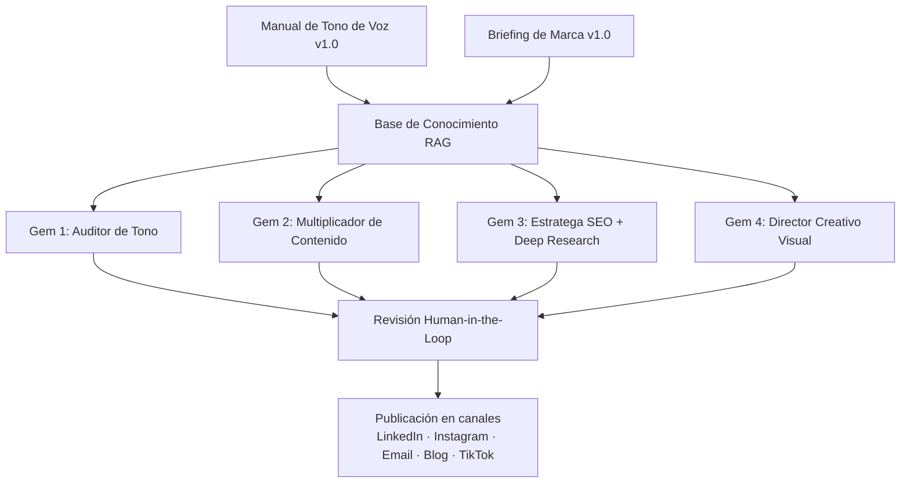

# Taranis Black Gems  
**Challenge One G11 — AI for Business**  
**Ruta 2: IA para Marketing y Contenidos**

Repositorio privado con todos los entregables del challenge aplicado a **Taranis Black** (mobiliario corporativo de ergonomía activa – líneas ErgoPro, SmartDesk y Silence).

---

## 📋 Orden de creación (paso a paso)

1. **Primero se crearon los Manuales de base de conocimiento**  
   - `docs/taranis_black_tono_de_voz_es_txt.txt` → Manual de Identidad Verbal y Tono de Voz v1.0  
   - `docs/taranis_black_briefing_de_marca_es_txt.txt` → Briefing de Marca Corporativo v1.0  

   Estos dos documentos son la **fuente de verdad (RAG)** que alimenta a todas las Gems/Skills.

2. **Luego se diseñaron los 3 AI Canvas** (ver carpeta `docs/` o PDFs originales).

3. **Se configuraron las 4 Gems** con los prompts de sistema que están en la carpeta `prompts/`:
   - Auditor de Identidad Verbal y Tono de Voz
   - Multiplicador de Contenido Semilla
   - Especialista en SEO y Estrategia de Campañas B2B
   - Director Creativo Visual

4. **Se generaron ejemplos reales** de outputs y assets visuales.

---

## 🏗️ Arquitectura del sistema



### Agentes implementados

| # | Agente | Función principal | Archivo de prompt |
|---|--------|-------------------|-------------------|
| 1 | **Auditor de Identidad Verbal** | Evalúa borradores (1-10), detecta palabras prohibidas, reescribe en tono Taranis | `prompts/auditor-de-tono-de-voz.md` |
| 2 | **Multiplicador de Contenido Semilla** | Transforma 1 contenido semilla → 4/6 formatos listos (Blog, Email, LinkedIn, Newsletter…) | `prompts/multiplicador-de-contenido.md` |
| 3 | **Estratega SEO & Campañas** | Investigación real + estructuras SEO + Topic Clusters + GEO | `prompts/seo-estrategico.md` |
| 4 | **Director Creativo Visual** | Fichas de dirección de arte + prompts técnicos en inglés para generación de imágenes | `prompts/director-creativo.md` |

---

## 📁 Estructura del repositorio

```
taranis-black-gems/
├── README.md
├── docs/
│   ├── taranis_black_tono_de_voz_es_txt.txt      ← Manual de Tono (fuente de verdad)
│   ├── taranis_black_briefing_de_marca_es_txt.txt ← Briefing de Marca
│   ├── politica-gobernanza-etica.md              ← Resumen de política
│   └── ai-canvas-resumen.md
├── prompts/
│   ├── auditor-de-tono-de-voz.md
│   ├── multiplicador-de-contenido.md
│   ├── seo-estrategico.md
│   └── director-creativo.md
├── examples/
│   └── (outputs de ejemplo)
├── architecture/
│   └── diagrama-flujo.md
└── assets/
    └── (imágenes de producto generadas)
```

---

## 🔗 Enlaces a las Gems originales (Google Gemini)

> Nota: A partir del 17/11/2025 las Gems están migrando a **Skills**. Los enlaces pueden cambiar.

- **Auditor de Tono**: https://gemini.google.com/gem/1mgUNS7Rsu6Oj_IeBkj4USKk39R5wjgn6?usp=sharing  
- **Multiplicador de Contenido**: https://gemini.google.com/gem/1lh6k7eX1xQh4-m-gcddIqn_ofa93MVXP?usp=sharing  
- **SEO Estratégico**: https://gemini.google.com/gem/18XQNusWRCaE35wQVHqIdaK1CyIRkGaFn?usp=sharing  
- **Director Creativo**: https://gemini.google.com/gem/1hw6INvrdKpGI1MkEZKgBzumH-I3k60kN?usp=sharing  

---

## 🎯 Métricas de éxito definidas

| Iniciativa | Meta |
|------------|------|
| Auditor de Tono | 80% menos retrabajos · 100% de piezas alineadas a los 4 pilares |
| Multiplicador | 75% reducción tiempo de producción multicanal |
| SEO Estratégico | +30% tráfico orgánico calificado · 60% menos tiempo de investigación |

---

## 🔒 Gobernanza

- Uso **exclusivo** de entornos Enterprise (Google Gemini Enterprise)
- **Human-in-the-Loop** obligatorio antes de cualquier publicación
- Prohibido cargar datos personales sin anonimizar
- Cumplimiento: Ley 25.326 (Argentina), LGPD, RGPD, ISO/IEC 42001

---

**Autora**: Noelia Natalia María Orsini  
**Cohorte**: G11 · Alura / StartSe  
**Fecha**: Noviembre 2025 / 2026

---

*Este repositorio documenta el trabajo completo del Challenge One – Ruta 2.*
