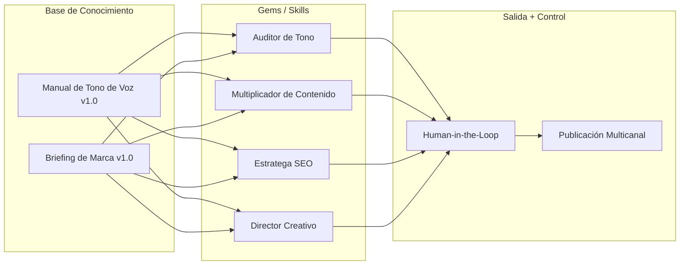

# Diagrama de Flujo — Sistema de Agentes Taranis Black

## Flujo recomendado de trabajo diario

1. **Estrategia** → Gem SEO genera estructura / calendario
2. **Producción** → Gem Multiplicador genera piezas desde contenido semilla
3. **Calidad** → Gem Auditor revisa y ajusta tono
4. **Visual** → Gem Director Creativo genera assets
5. **Publicación** → Revisión humana final + publicación
